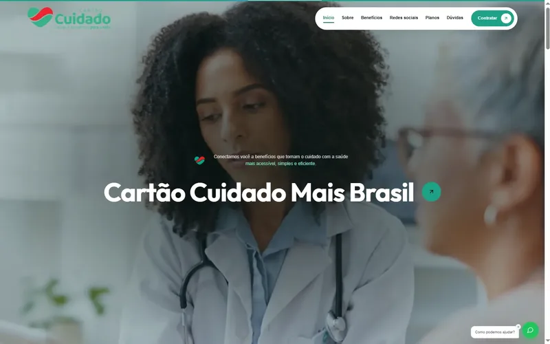
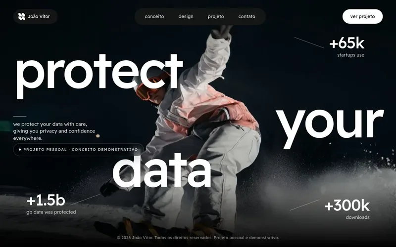
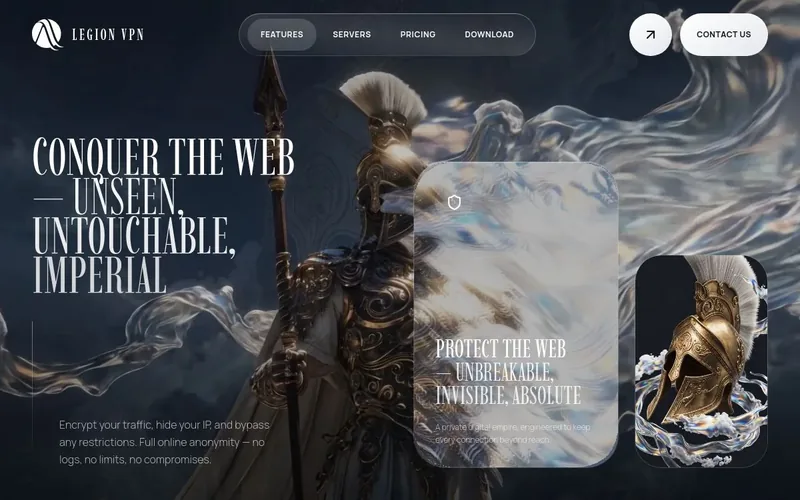
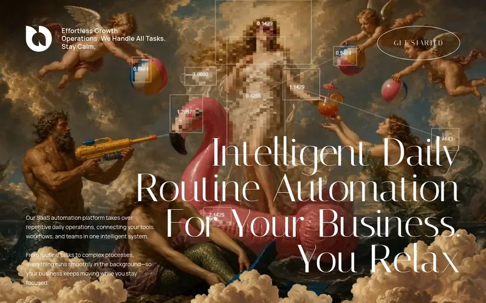
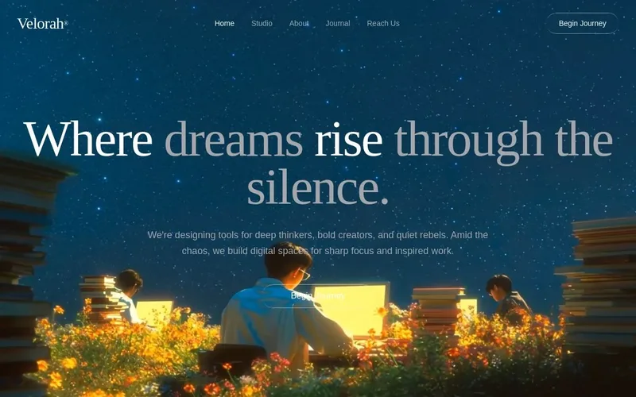
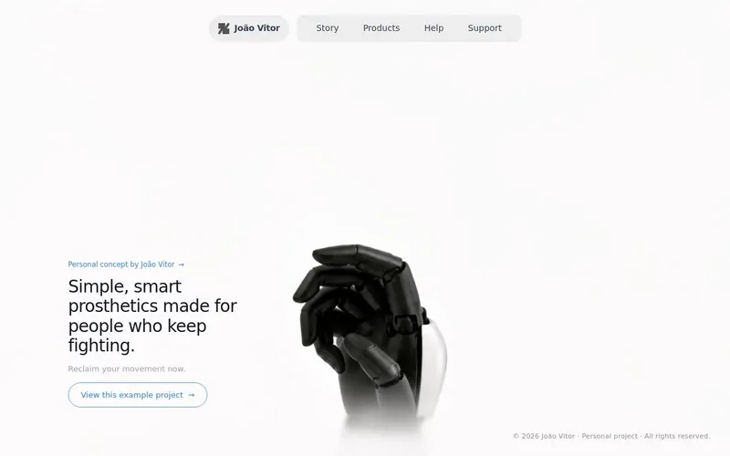
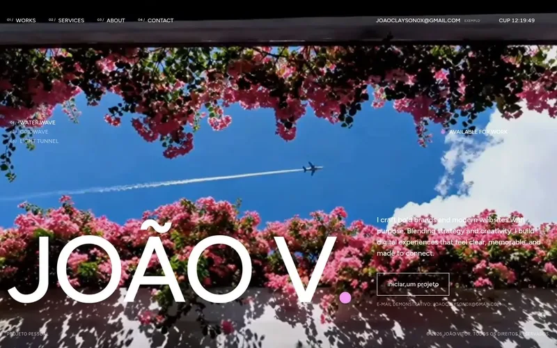

<a href="https://joaoclayson0x.dev">
  <picture>
    <source media="(prefers-color-scheme: dark)" srcset="https://raw.githubusercontent.com/joaoclayson0x/joaoclayson0x/main/assets/banner-dark.svg" />
    <source media="(prefers-color-scheme: light)" srcset="https://raw.githubusercontent.com/joaoclayson0x/joaoclayson0x/main/assets/banner-light.svg" />
    
  </picture>
</a>

<p align="center">
  <a href="https://joaoclayson0x.dev"></a>
  <a href="https://www.linkedin.com/in/jo%C3%A3o-vitor-827058407"></a>
  <a href="https://www.instagram.com/joaoclayson0x/"></a>
  <a href="https://www.youtube.com/@joaoclayson0x"></a>
</p>

<br />

## `01` / Sobre

Desenvolvedor front-end que transforma ideia em interface: **responsiva, acessível e com cuidado no detalhe**.
Gosto de onde design e engenharia se encontram — tipografia, movimento e código limpo no mesmo lugar.

Hoje construo sites institucionais e projetos demonstrativos com React e Next.js, e estou expandindo para
back-end, automação e dados no caminho para o **full stack**.

```ts
const joao = {
  role: "Desenvolvedor Front-end → Full Stack",
  studying: "Análise e Desenvolvimento de Sistemas",
  stack: ["React", "Next.js", "TypeScript", "Tailwind CSS"],
  exploring: ["Back-end", "Automação com Python", "Cibersegurança", "Dados"],
  shipsTo: "Vercel",
  motto: "Nem toda evolução se torna um commit.",
};
```

<br />

## `02` / Stack

<table>
  <tr>
    <td width="150"><sub><b>FRONT-END</b></sub></td>
    <td></td>
  </tr>
  <tr>
    <td><sub><b>LÓGICA & AUTOMAÇÃO</b></sub></td>
    <td></td>
  </tr>
  <tr>
    <td><sub><b>DESIGN</b></sub></td>
    <td></td>
  </tr>
  <tr>
    <td><sub><b>FERRAMENTAS & DEPLOY</b></sub></td>
    <td></td>
  </tr>
</table>

<br />

## `03` / Projetos em destaque

<table>
  <tr>
    <td width="50%" valign="top">
      <a href="https://cartaocuidado.com.br/"></a>
      <p><sub>PROJETO REAL · SITE INSTITUCIONAL</sub><br /><b>Cartão Cuidado Mais Brasil</b></p>
      <p>Benefícios e planos organizados para o visitante entender a proposta e chegar ao atendimento.</p>
      <p><code>HTML</code> <code>CSS</code> <code>JavaScript</code> <code>SEO</code></p>
      <a href="https://cartaocuidado.com.br/"><b>Ver site →</b></a>
    </td>
    <td width="50%" valign="top">
      <a href="https://projeto-4-eight-black.vercel.app/"></a>
      <p><sub>DEMONSTRATIVO · CONCEITO SAAS</sub><br /><b>Plataforma de Segurança de Dados</b></p>
      <p>Interface para proteção de dados com tipografia ampla, vídeo em tela cheia e direção visual própria.</p>
      <p><code>React</code> <code>Vite</code> <code>TypeScript</code></p>
      <a href="https://projeto-4-eight-black.vercel.app/"><b>Ver site →</b></a>
    </td>
  </tr>
  <tr>
    <td width="50%" valign="top">
      <a href="https://projeto-5-lovat.vercel.app/"></a>
      <p><sub>DEMONSTRATIVO · LANDING PAGE</sub><br /><b>Landing Page de VPN</b></p>
      <p>Apresentação de produto focada em privacidade digital, com card de vidro líquido e animações.</p>
      <p><code>React</code> <code>TypeScript</code> <code>Motion</code></p>
      <a href="https://projeto-5-lovat.vercel.app/"><b>Ver site →</b></a>
    </td>
    <td width="50%" valign="top">
      <a href="https://projeto-6-five.vercel.app/"></a>
      <p><sub>DEMONSTRATIVO · AUTOMAÇÃO EMPRESARIAL</sub><br /><b>Site de Automação Empresarial</b></p>
      <p>Conceito de site para automação de rotinas, com vídeo de fundo e transição em parallax.</p>
      <p><code>React</code> <code>TypeScript</code> <code>Motion</code></p>
      <a href="https://projeto-6-five.vercel.app/"><b>Ver site →</b></a>
    </td>
  </tr>
  <tr>
    <td width="50%" valign="top">
      <a href="https://projeto-3-weld.vercel.app/"></a>
      <p><sub>DEMONSTRATIVO · EXPERIÊNCIA DIGITAL</sub><br /><b>Experiência Visual de Marca</b></p>
      <p>Hero cinematográfico com vídeo em tela cheia, efeito <i>liquid glass</i> e tipografia editorial.</p>
      <p><code>Next.js</code> <code>React</code> <code>Tailwind CSS</code></p>
      <a href="https://projeto-3-weld.vercel.app/"><b>Ver site →</b></a>
    </td>
    <td width="50%" valign="top">
      <a href="https://projeto-1-zeta-one.vercel.app/"></a>
      <p><sub>DEMONSTRATIVO · LANDING PAGE</sub><br /><b>Landing Page de Próteses</b></p>
      <p>Landing page conceitual sobre próteses, explorando apresentação de produto e composição.</p>
      <p><code>React</code> <code>Vite</code> <code>TypeScript</code></p>
      <a href="https://projeto-1-zeta-one.vercel.app/"><b>Ver site →</b></a>
    </td>
  </tr>
  <tr>
    <td width="50%" valign="top">
      <a href="https://projeto-2-eta-seven.vercel.app/"></a>
      <p><sub>DEMONSTRATIVO · PORTFÓLIO EXPERIMENTAL</sub><br /><b>Portfólio Criativo</b></p>
      <p>Portfólio com foco em imagem, expressão visual e navegação com movimento.</p>
      <p><code>Next.js</code> <code>TypeScript</code> <code>CSS Animations</code></p>
      <a href="https://projeto-2-eta-seven.vercel.app/"><b>Ver site →</b></a>
    </td>
    <td width="50%" valign="middle" align="center">
      <a href="https://joaoclayson0x.dev"><b>Ver todos os projetos no portfólio →</b></a>
      <p><sub>joaoclayson0x.dev</sub></p>
    </td>
  </tr>
</table>

<p align="center">
  <sub>Os repositórios dos projetos são privados — todos estão publicados e podem ser vistos ao vivo.</sub>
</p>

<br />

## `04` / Trilha

| | Formação | Foco |
|:-:|---|---|
| 🔵 | **Análise e Desenvolvimento de Sistemas** · <sub>ATUAL</sub> | Programação, banco de dados e soluções digitais |
| ⚪ | **Ciência da Computação** · <sub>PRÓXIMA</sub> | Algoritmos, estruturas de dados e fundamentos |
| ⚪ | **Ciência de Dados** · <sub>PLANEJADO</sub> | Análise e modelos aplicados a problemas reais |
| ⚪ | **Engenharia de Software** · <sub>PLANEJADO</sub> | Arquitetura, qualidade e sistemas em escala |

<br />

## `05` / Atividade

<picture>
  <source media="(prefers-color-scheme: dark)" srcset="https://raw.githubusercontent.com/joaoclayson0x/joaoclayson0x/output/github-snake-dark.svg" />
  <source media="(prefers-color-scheme: light)" srcset="https://raw.githubusercontent.com/joaoclayson0x/joaoclayson0x/output/github-snake.svg" />
  
</picture>

<br />

## `06` / Contato

Aberto a conexões, colaborações e oportunidades em desenvolvimento web.
O melhor caminho é pelo [LinkedIn](https://www.linkedin.com/in/jo%C3%A3o-vitor-827058407) ou pelo [portfólio](https://joaoclayson0x.dev).

<br />

<p align="center">
  <sub><code>Nem toda evolução se torna um commit.</code></sub>
</p>
